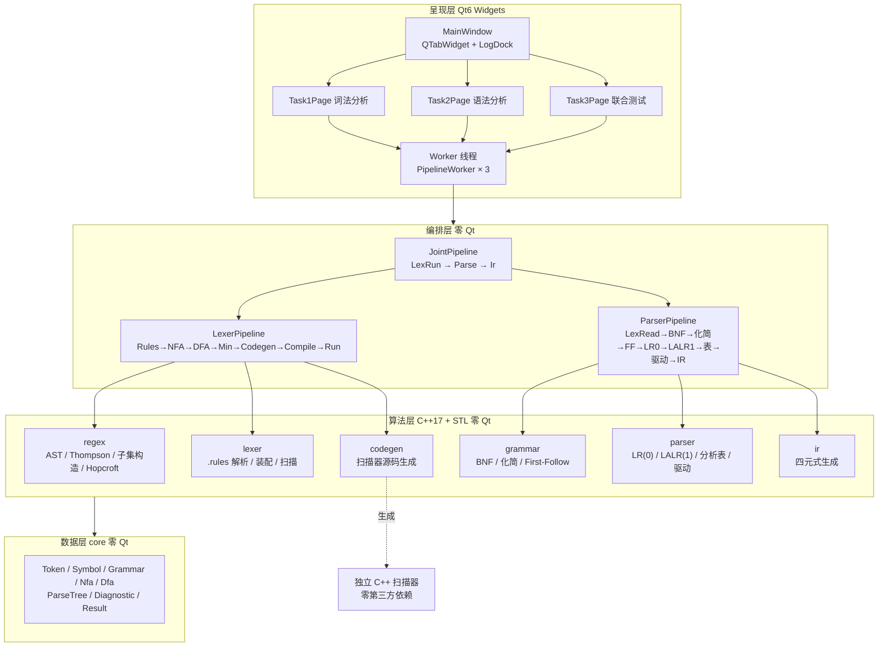
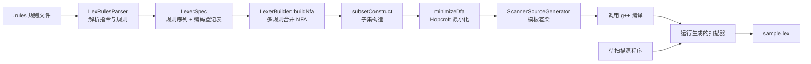
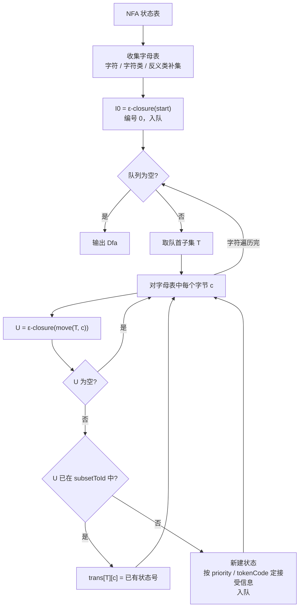
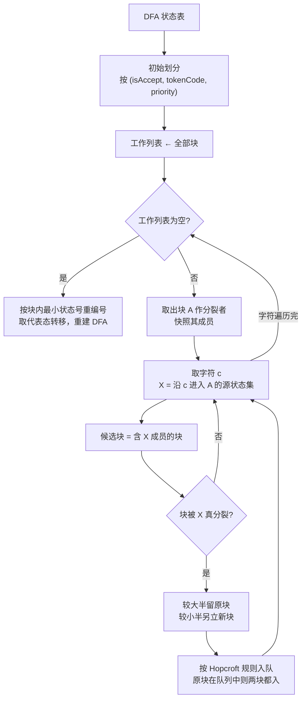
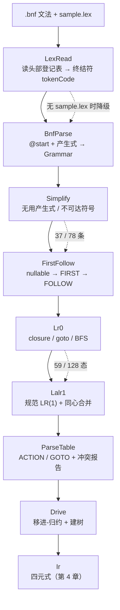
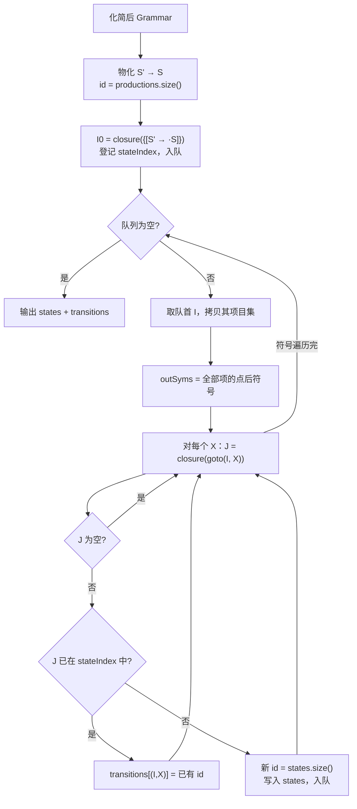
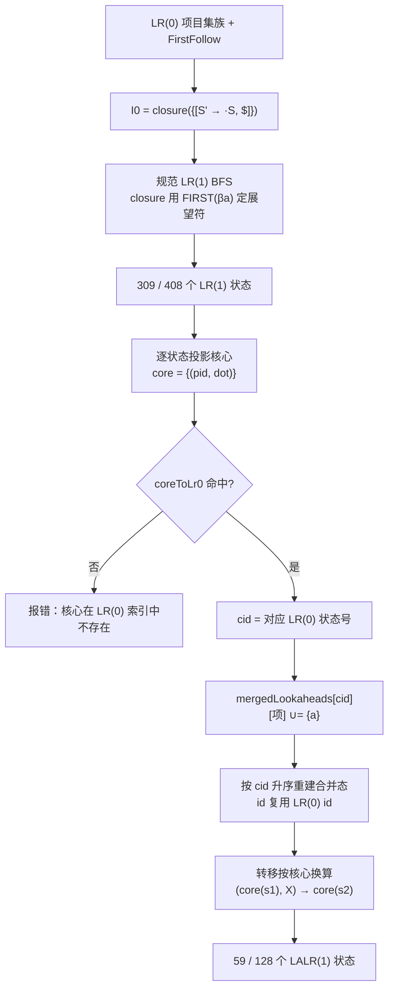
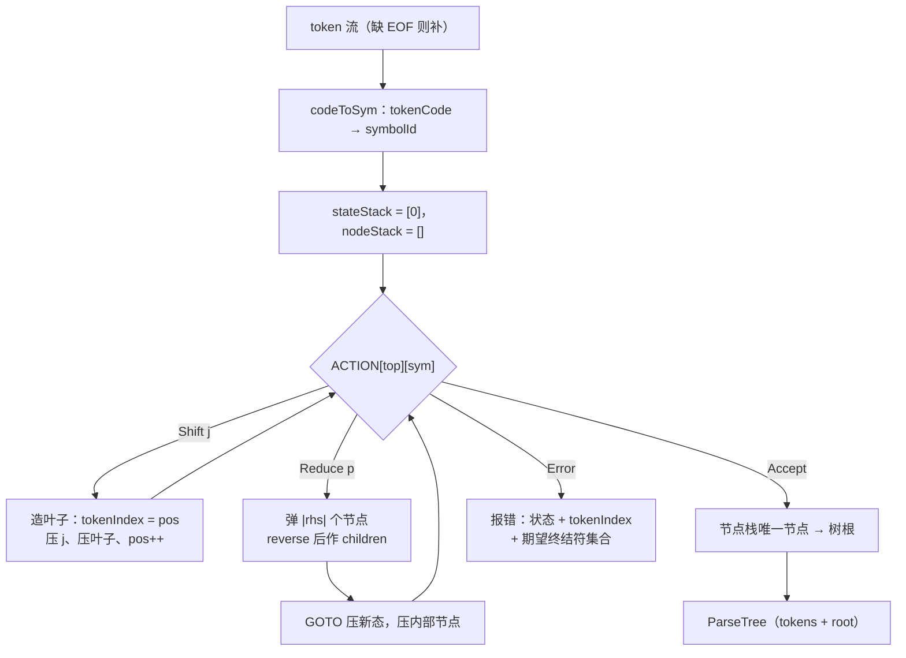
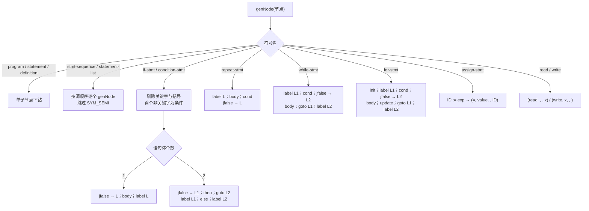
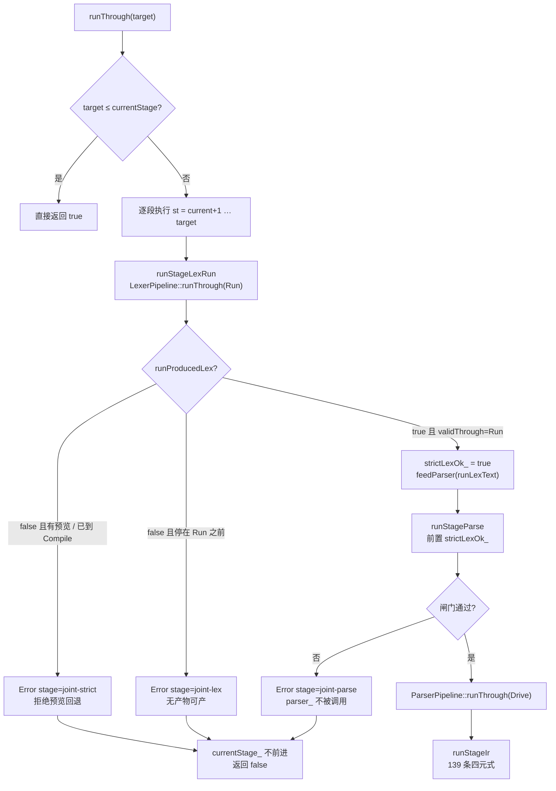

# 编译原理课程设计实验报告书

> 本文件为报告正文源稿（Markdown 先行）。图号为 Mermaid 代码块，图题写在其上；表题为三线表样式，编号按章。

## 摘要

本课程设计实现了一个配置驱动的编译器前端自动化生成与验证系统：以语言包（`.rules` 词法规则、`.bnf` 文法）为唯一语言相关输入，完成"正则 → NFA → DFA → 最小化 → 生成 C++ 词法分析源程序 → 编译运行"与"BNF → 化简 → First/Follow → LR(0) → LALR(1) → 分析表 → LR 驱动 → 语法树 → 四元式"两条自动生成链，并在同一 Qt 应用中以三个 Tab 完成词法分析、语法分析与 Mini-C 端到端联合测试。系统共 9 个模块、源码约 1.45 万行、单元测试约 0.54 万行（C++17），核心数据结构不依赖 Qt，生成的扫描器可脱离本工程独立编译。

实测结果：TINY 语言 26 条规则经 Thompson 构造得 121 个 NFA 状态，子集构造得 52 个 DFA 状态，最小化后 50 个，扫描 105 个单词（含 EOF）零错误；Mini-C 语言 35 条规则得 165 个 NFA 状态、70 个 DFA 状态、66 个最小状态，对 416 个单词的源程序零错误。语法侧 TINY 化简后 37 条产生式、59 个 LR(0)/LALR(1) 状态、分析表零冲突、41 条四元式；Mini-C 78 条产生式、128 个状态、恰 1 处移进-归约冲突（悬垂 `else`）、139 条四元式。任务三以真实生成扫描器产出的 `sample.lex` 驱动语法分析，语法树 1370 个节点、深度 51。

**关键词**：词法分析；LALR(1)；四元式；自动机最小化；配置驱动

---

## 第 1 章 概述与系统总体设计

### 1.1 设计任务、完成情况与技术路线

课程设计包含三个递进任务：任务一由正则规则自动生成可独立编译运行的扫描器；任务二由 BNF 文法自动构造 LALR(1) 分析表并完成语法分析与建树；任务三用 Mini-C 语言把前两者串成真实链路做端到端验收。任务书标注为"选做"的**词法分析源程序生成**与**中间代码生成**均按必做实现，因此交付物是完整链路而非片段。

表 1-1 三个任务的输入、处理与交付物

| 任务 | 输入 | 主要处理 | 交付物 |
| --- | --- | --- | --- |
| 任务一 | `.rules`、待扫描源程序 | 正则解析 → Thompson → 子集构造 → 最小化 → 生成 C++ 源码 → 编译 → 运行 | 最小 DFA、`generated_lexer.cpp`、`<lang>_scanner`、`sample.lex` |
| 任务二 | `.bnf`、`sample.lex` | BNF 解析 → 化简 → First/Follow → LR(0) → LALR(1) → 分析表 → 驱动 → 中间代码 | 化简后文法、FIRST/FOLLOW、项目集族、ACTION/GOTO、语法树、四元式 |
| 任务三 | Mini-C 语言包、`test.minic` | `JointPipeline` 严格串联任务一与任务二（禁止进程内预览回退） | `sample.lex`、`*.tree.txt`、`*.ir.txt`、联合测试报告 |

任务书的 9 项硬性要求及落实位置见表 1-2。其中第 3 条"禁止写死 TINY"是所有架构决策的出发点：程序里没有任何关键字、界符或产生式被硬编码，更换语言只需替换语言包目录。

表 1-2 硬性要求与落实位置

| # | 硬性要求 | 落实位置 |
| --- | --- | --- |
| 1 | C++17 + Qt Widgets + CMake | 顶层 `CMakeLists.txt`，目标 `CompilerCourseApp` |
| 2 | 单一应用，Tab / Dock 区分功能 | `MainWindow`：`QTabWidget` 三页 + 可关闭日志 Dock |
| 3 | 语言无关，禁止写死 TINY | 语言行为全部由 `.rules` / `.bnf` 驱动 |
| 4 | 统一数据结构 | `src/core` 九个头文件，全工程共用 |
| 5 | 统一文件格式 | `.rules`、`.bnf`、`sample.lex`（自描述头部）三套契约 |
| 6 | 生成的词法源程序可独立编译运行 | `core`/`lexer` 零 Qt 依赖，生成源码零外部依赖 |
| 7 | 主窗口含三个任务页 | `Task1Page` / `Task2Page` / `Task3Page` |
| 8 | 先文档后代码 | `docs/` 五份设计文档 + 进度记录先行更新 |
| 9 | 任务一/二接口供任务三复用 | `TokenCodeRegistry`、`PipelineSnapshot`、`JointSnapshot` 值语义传递 |

技术路线可概括为"两条自动生成链 + 一个统一宿主"：词法链把规则文本逐级下降到可执行程序，语法链把文法文本逐级下降到分析表与语法树；两条链都由零 Qt 的流水线类编排，Qt 只负责呈现与线程调度。直接收益是**算法可单测**——全部 13 项 CTest 用例均不创建 `QApplication`，可在无图形环境的命令行中复现报告中的每一个数字。

### 1.2 系统总体架构与模块划分

系统按"呈现 / 编排 / 算法 / 数据"四层组织，依赖方向严格单向向下（图 1-1）。呈现层由 `MainWindow` 与三个任务页组成，每页配一个 `QThread` 工作对象，把耗时步骤移出 UI 线程并以快照回传；编排层是三个零 Qt 流水线类，用阶段枚举把长流程切成可单独触发的小步；算法层按职责切成六个静态库；数据层 `core` 只放纯数据结构与诊断载体。

图 1-1 系统总体架构



三层数据流正是由此贯通：`.rules` 经词法链得到可执行扫描器，扫描器运行后产出 `sample.lex`；该文件头部自带"编码—名称—显示名"登记表，因此语法链无需任何外部映射文件即可把 `.bnf` 中的终结符名换算成词法编码。这是任务一与任务二之间唯一的耦合点，也是任务三"换语言不改代码"的关键。各模块职责与依赖见表 1-3，一条硬约束是 `grammar` / `parser` 不允许被任务一反向依赖、`lexer` 也不含语法逻辑——这保证生成的扫描器在编译链接时不会拖入八万行语法代码。

表 1-3 模块职责与依赖

| 模块 | 主要类 | 职责 | 依赖 |
| --- | --- | --- | --- |
| `core` | `Token`、`Grammar`、`Nfa`、`Dfa`、`ParseTreeNode`、`Result` | 统一数据结构与诊断载体，无算法 | 仅 STL |
| `regex` | `RegexParser`、`RegexToNfa`、`NfaToDfa`、`MinimizeDfa` | 正则 AST、Thompson 构造、子集构造、Hopcroft 最小化 | core |
| `lexer` | `LexRulesParser`、`LexerBuilder`、`Scanner` | 规则解析、自动机装配、表驱动扫描、`sample.lex` 读写 | core, regex |
| `codegen` | `ScannerSourceGenerator` | 最小 DFA 序列化 + 模板渲染为独立源码 | core, lexer |
| `grammar` | `BnfParser`、`GrammarSimplifier`、`FirstFollow` | 文法解析、化简、FIRST/FOLLOW/nullable | core |
| `parser` | `Lr0Automaton`、`Lalr1Builder`、`ParseTable`、`LrDriver` | 项目集族、同心合并、分析表、移进-归约驱动 | core, grammar |
| `ir` | `IrGenerator` | 语法树 → 四元式，含回填与左值处理 | core, grammar, parser |
| `pipeline` | `LexerPipeline`、`ParserPipeline`、`JointPipeline` | 阶段化编排、快照与诊断汇聚 | 上述算法模块 |
| `gui` / `app` | `MainWindow`、`Task*Page`、`*Worker` | 界面、线程、外部编译器调用 | 全部（Qt6） |

编排层统一采用"阶段枚举 + 快照"：以任务二为例，`ParseStage` 定义 `LexRead → BnfParse → Simplify → FirstFollow → Lr0 → Lalr1 → ParseTable → Drive → Ir` 九个阶段，`runThrough(stage)` 自动补齐上游，任一步失败即停止并写入带 `stage` 字段的诊断。GUI 的九个单步按钮与 `--parse` 命令行因此共享同一份实现。系统主界面如图 1-2，后续各章引用的状态数、单词数、四元式条数均直接取自该面板日志。

图 1-2 系统主界面（任务一语言包已加载并完成一次运行）

（截图：`docs/prtsc/t0_mainwindow.png`）

### 1.3 统一数据结构、开发环境与文件格式

统一数据结构是三个任务能够拼装的前提。`core` 中九个结构的特点是"只描述数据、不含算法、以值语义为主"，因此可自由跨线程拷贝，单元测试也能直接构造输入而无需搭流水线。三处约定贯穿全文：其一，编码 `0` 固定为 EOF（显示名 `$`）、`255` 固定为 ERROR，规则文件只分配 1..N，任何语言的 `sample.lex` 都能被同一个读取器消费；其二，扫描采用**最长匹配**，长度相同时取**规则文件中先声明者**，这一条同时解决 `<=` 与 `<`、关键字与标识符的冲突；其三，ε 产生式统一表示为空的 `rhs` 向量而非放入 ε 符号，使 LR 项的"点到达末尾"与"归约"判定无需特判。

表 1-4 三套文件格式

| 文件 | 生产者 | 消费者 | 结构要点 |
| --- | --- | --- | --- |
| `.rules` | 手写 / 语言包 | `LexRulesParser` | 指令行（`@name`、`@case-sensitive`、`@ignore`、`@comment`）+ 规则行；支持字面量列表与显式编码 |
| `.bnf` | 手写 / 语言包 | `BnfParser` | `@start` 声明开始符号；产生式 `A -> α \| β ;`；终结符写登记名或用引号字面量 |
| `sample.lex` | 生成的扫描器 | `SampleLexReader` | `#token code name display` 头部 + 数据区 `code lexeme`，头部自描述 |

开发与运行环境为 Windows 10/11 x64、Qt 6.11.0（MinGW 64-bit）、g++ 13.1.0（`-std=c++17`）、CMake ≥ 3.16。程序提供四个入口，报告中的全部数据均可由命令行复现，无需图形界面：

```bash
cmake -S . -B build -DCMAKE_BUILD_TYPE=Release && cmake --build build -j
./build/app/CompilerCourseApp.exe                      # 图形界面（三个 Tab）
./build/app/CompilerCourseApp.exe --lex   <rules> <src> [out.lex]
./build/app/CompilerCourseApp.exe --parse <bnf>   <lex> [out.ir]
./build/app/CompilerCourseApp.exe --minic <langDir> <src> [outDir]
```

后续章节与三个任务一一对应：第 2 章讲词法链，第 3 章讲语法链，第 4 章讲中间代码，第 5 章讲联合测试与系统集成。每个核心模块按"算法实现 → 流程图 → 关键源程序 → 单元测试"展开，重点交代本系统的具体做法与实测数据，通用理论从略。

---

## 第 2 章 任务一：词法分析器的自动生成

本章交付的不是一个手写的扫描器，而是"规则进、程序出"的生成器：输入一份 `.rules` 文本，输出一个不依赖本工程任何库的 C++ 扫描器，再由它产出 `sample.lex`。重点在两段自动转换——文本到自动机、自动机到源码——以及这两段的正确性证据。

### 2.1 处理流程与 `.rules` 规则解析

词法链共七个阶段，前一阶段的产物是后一阶段的唯一输入（图 2-1）。七阶段由 `LexerPipeline::runThrough(Stage)` 编排，`Stage` 枚举从 `Rules` 到 `Run` 依次递进，任一步失败即停止并写入带 `stage` 字段的诊断，因此界面上"只生成 NFA""只最小化"等单步按钮与"一键运行"走的是同一段代码。

图 2-1 词法分析流水线



规则文件的语法只有两类行：以 `@` 开头的指令行，和"登记名 = 模式"的规则行。指令决定语言级行为（`@name`、`@case-sensitive`、`@ignore`、`@comment`），规则行决定单词集合；支持带 `rule` 前缀、省略前缀、以及带显式编码的 `<名称><编码>L = a | b | c` 三种写法，后者展开后每个字面量各占一个编码。三个设计决定值得单独说明。

**其一，关键字只登记编码、不参与自动机。** 若把关键字也建成 DFA 分支，它们会与标识符正则在自动机中大量重合，白白增大状态数。系统的做法是：`KW_` 前缀的规则只写入编码表并记入 `keywordLookup`，自动机只由 ID 规则识别"看起来像标识符"的词，命中后再按 `keywordLookup`（键做 ASCII 小写折叠）重分类。因此 TINY 声明 `@case-sensitive false` 时，源码里的 `READ`、`read`、`Read` 都落到 `KW_READ`，而 `lexeme` 保留原文。

**其二，编码由语言包显式指定，`0` 与 `255` 保留。** `TokenCodeRegistry` 只负责校验与登记。TINY 使用 `100` NUM、`101` ID、`103–110` 关键字、`200–215` 运算符；Mini-C 使用 `100` NUM、`101` ID、`102` 注释、`103–111` 关键字、`200–222` 运算符。编码与语言绑定、与程序无关，任务二拿到任何一份 `sample.lex` 都能凭头部表还原语义。

**其三，优先级即文件顺序。** `priority` 取规则在文件中的序号（0 基），最长匹配、长度相同取 `priority` 更小者，解决了 `<=` 与 `<`、`<>` 与 `<` 这类前缀重合；关键字与标识符的冲突则由上一条的重分类消化。

解析阶段还有一道装配期校验：全部规则合并成总 NFA 后，从起点求 ε-闭包，若闭包含接受态，说明某条规则能匹配空串——扫描时会因指针不前进而死循环，因此直接以 `stage="nfa-build"` 报错终止，不留给运行期。两个语言包的规模见表 2-1：TINY 的 26 条规则中 8 条关键字不进自动机，实际参与构造 18 条；Mini-C 的 35 条中 9 条关键字不进自动机，参与构造 26 条（含一条注释规则，注释会生成 DFA 以便与 `/` 做最长匹配，命中后按 `commentCodes_` 丢弃）。

表 2-1 两个语言包的规则构成

| 项目 | TINY | Mini-C |
| --- | --- | --- |
| 规则总数 | 26 | 35 |
| 关键字（不建自动机） | 8 条：`103–110` | 9 条：`103–111` |
| 数值 / 标识符 / 注释 | `NUM 100`、`ID 101` | `NUM 100`、`ID 101`、`Comment 102` |
| 运算符与界符 | 16 条：`200–215` | 23 条：`200–222` |
| 登记项（含 `0=EOF`、`255=ERROR`） | 28 | 37 |
| 大小写 / 注释 | 不区分；`@comment block { }` | 区分；`@comment line //` |

### 2.2 正则表达式 → NFA（Thompson 构造）

构造把正则的语法结构逐层翻译成"片段"：每个片段由入口与出口状态界定，片段之间用 ε 边拼接。系统用轻量的 `Fragment` 记录两端状态号，状态与边统一存放在 `Nfa` 中，整个构造只维护一个状态容器。

**第一步，文本到 AST。** `RegexParser` 按"选择 → 连接 → 重复 → 原子"四级优先级递归下降，产出字符、字符类、反义类、任意字符、连接、选择与三种重复节点。字符类在解析期就把 `a-z` 这类区间展开成有序字节集合，反义类只保存被排除的集合，真正的补集运算推迟到子集构造收集字母表时再做——这样 AST 体积小，且补集语义只在一个地方实现。

**第二步，AST 到片段。** 按节点类型分派：字符/字符类/反义类新建两态、加一条携带字符或字符集的边；连接 `αβ` 递归得到两段后加一条 ε 边 `α.accept → β.start`；选择 `α|β|γ` 新建 `s`、`a`，各分支 ε 入 ε 出；闭包 `α*` 新建 `s`、`a` 并加四条 ε 边（进入、循环、零次、退出）；`α+` 与 `α?` 与 `*` 只差一条边，去掉零次边或循环边即可，避免为三种重复各写一套状态布局。由于实际模式最深不超过十层，这里用递归而非显式后缀栈，代码更短且不会爆栈。

**第三步，多规则合并与校验。** 每条规则独立构造出小 NFA，`LexerBuilder::buildNfa` 逐条取出，用当前已合并状态数作偏移量整体平移状态号与边目标，再新建总起点向各规则入口加 ε 边，最后把编码与优先级写到出口状态上。合并后对总起点求一次 ε-闭包，含接受态即报"规则可匹配空串"。

实测：正则 `a(b|c)*` 经 `buildNfaFromRegex` 得 10 个状态，字符边 3 条，与手算逐项一致；TINY 的 18 条参与规则合并后得 121 个 NFA 状态，平均每条约 6.7 个状态，无诊断输出。单测另覆盖字面量、字符类、反义类、连接、选择、三种重复与转义共 20 余个用例。

### 2.3 NFA → DFA（子集构造）与 DFA 最小化（Hopcroft）

**子集构造。** 先收集字母表：字符边取其字符，字符类取其展开集，反义类取 `0..255` 中不在排除集内的字节——补集运算一次做尽。初始状态取起始态的 ε-闭包并编号 0，随后 BFS 推进：弹出子集 `T`，对每个字节 `c` 计算 `U = ε-closure(move(T, c))`，为空则跳过，否则查 `subsetToId`，命中连线、未命中新建状态并压入队列。接受信息在新建状态时一次定型：取子集内 `priority` 最小的接受态，并列时取 `tokenCode` 更小者——同一个 DFA 状态可能同时是 `<` 与 `<=` 的中间结果，只有携带唯一编码才能输出确定 token。流程图见图 2-2。

图 2-2 子集构造流程图



**最小化。** 初始划分不能只分"接受/非接受"两类：若把 `100 NUM` 与 `101 ID` 的终态并成一类，最小化后就分不清该报哪个 token。因此按三元签名 `(isAccept, tokenCode, priority)` 分组。精化采用 Hopcroft 的"分裂者"策略：工作列表初始为全部块，每取一块 `A`，对每个字符 `c` 用逆转移表求 `X`（所有沿 `c` 一步进入 `A` 的状态），再看 `X` 落在哪些块中，把这些块按"是否属于 `X`"一分为二。分裂时**较大的一半留原块、较小的一半另立新块**——只有较小的一半需要重新入队，总代价压到 `O(n log n)`；实现里用自增的 `generation` 时间戳代替每轮清空标记数组。精化结束后按"块内最小状态号"排序重编号，取代表态的转移重建 DFA（图 2-3）。

图 2-3 DFA 最小化流程图



实测：TINY 由 121 个 NFA 状态收敛到 52 个 DFA 状态，最小化后 50 个（合并 2 个等价态）；Mini-C 由 165 收敛到 70，最小化后 66 个（合并 4 个）。两语言包最小化前后扫描结果逐 token 一致，`lexer_pipeline_test` 全部通过。这一"状态数下降但语言不变"的双向验证，是后续所有状态数锚点的前提。

### 2.4 词法分析源程序生成、编译运行与单元测试

代码生成不再操作自动机抽象结构，而是把最小 DFA 压成三张常量表加一段 `switch` 骨架。不直接输出 256 列转移矩阵，是因为 50 态 × 256 字节 = 12800 个整数，既占篇幅又不便人读；改为"每状态只列有转移的区间"，生成的源码不到 700 行且可逐行核对。

**区间压缩。** 对每个状态把 `(字节, 目标)` 按字节升序排序后线性扫描：下一个字节正好是当前区间上界 +1 且目标相同就并入，否则另起一段。压缩后一段区间只需一次条件判断，并按长度生成三种最优写法——单字节 `c == 107`、双字节 `c == 60 || c == 62`、更长 `c >= 48 && c <= 57`。

**模板渲染与编译。** 生成器把 `ACC[]`、状态分支、关键字表、注释编码表与语言名填入 `scanner_main.cpp.in`，输出 `generated_lexer.cpp`；随后 `LexerPipeline` 经 `CompileRunBackend` 抽象调用 `g++ -std=c++17 -O2`，输出 `<lang>_scanner`，失败时把编译器 stderr 原样写入诊断（`stage="compile"`）。

**运行与回写。** 以 `<lang>_scanner <源文件> [输出文件]` 运行，缺省输出 `sample.lex`：头部是 `#token <code> <name> <display>` 自描述表，数据区每行 `<code> <lexeme>`，末尾附 token 总数与错误数。头部使这份文件自带语义，任务二不必再读一次 `.rules`。运行期与生成代码共用同一套最长匹配逻辑：每进入一个接受态就记录位置，无转移或到文件末尾时回退到最近记录处产出 token；若从未进入接受态，产出 `255` 错误 token 并把指针前进一个字节，保证扫描不卡死。

```cpp
int state = startState_;
int lastAccept = -1;
size_t lastAcceptPos = size_t(-1);
size_t cur = begin;
while (cur < len) {
    const unsigned char cc = static_cast<unsigned char>(source[cur]);
    const int key = spec_->caseSensitive ? int(cc) : foldAsciiUpper(cc);
    const int next = trans_[state][key];
    if (next < 0) { break; }
    state = next;
    ++cur;
    if (acceptCode_[state] >= 0) { lastAccept = state; lastAcceptPos = cur; }
}
```

少一次记录就会把 `<=` 误切成 `<` 与 `=`，这是扫描正确性的关键。两语言包的实测结果见表 2-2，均零错误；生成的扫描器源码均在 700 行上下，脱离本工程单独编译后输出与进程内扫描逐 token 一致（图 2-4），`ctest` 全量 13 项通过（图 2-5）。

表 2-2 两个语言包的词法实测结果

| 指标 | TINY | Mini-C |
| --- | --- | --- |
| 规则数 / 登记项 | 26 / 28 | 35 / 37 |
| NFA 状态 | 121 | 165 |
| DFA 状态（最小化前） | 52 | 70 |
| 最小 DFA 状态 | 50 | 66 |
| 字母表大小（字节） | 49 | 82 |
| token 数（含 EOF） | 105 | 417 |
| ERROR 数 | 0 | 0 |

图 2-4 TINY 语言输出的 `sample.lex`（头部登记表 + 数据区）

（截图：`docs/prtsc/t1_tiny_lex.png`）

图 2-5 全部单元测试通过（`ctest` 13/13）

（截图：`docs/prtsc/t1_unit_test.png`）

### 2.5 跨环境编译器缺失与容错降级策略

本节的编译与运行依赖一个本工程之外的程序——系统 `g++`。这一依赖在开发环境与评阅环境中表现完全不同，交付前必须显式交代，否则"能跑"与"在别人机器上能跑"会被混为一谈。

**编译器的四级查找。** `LexerCompilerRunner` 按"显式配置 → 环境变量 `COMPILER_GXX` → Qt 自带 `Tools/mingw1310_64/bin/g++.exe` → `PATH`"的顺序定位编译器。在 Qt Creator 中启动时，前三级给出的绝对路径都指向开发机上的 MinGW，编译必然命中；打包成独立文件夹后，随包分发的运行库只有 `Qt6Core/Gui/Widgets` 等动态库，既无 MinGW 也无 `g++.exe`，四级查找全部落空，`QProcess` 直接启动失败，`compile` 阶段以 `stage=compile` 报错。此时系统有三层应对，前两层在运行期、第三层在交付环节。

其一，**进程内预览回退**。`LexerPipeline::runStageCompile` 在编译失败后立即调用 `buildPreviewLex`：用同一份最小 DFA 驱动运行期 `Scanner` 扫描源程序，经 `SampleLexWriter::render` 渲染出与真实运行**完全同格式**的文本（头部登记表 + 数据区），送入界面并打上"进程内预览（非真实运行结果）"的水印。这条路径保证缺编译器时既不崩溃也不白屏，且词法阶段的中间产物（NFA、DFA、最小 DFA、生成的 C++ 源码）照常可见——生成源码的渲染发生在编译之前，与外部编译器是否可用无关。

其二，**物理文件的边界**。回退只解决"看得见"，不解决"写得出"。生成的扫描器自身用 `std::ofstream` 直接写 `argv[2]`，而 `ofstream` 不创建尚不存在的多级目录；编译失败时 `run` 阶段又根本不会执行，`sample.lex` 因此只存在于内存。这里的取舍是刻意的：**预览不落盘**。若把预览当产物写出去，任务二读到的将是未经真实运行的文本，与 5.1 节"拒绝预览回退"的严格闸门自相矛盾——容错可以降低可见性，但不能伪造证据。

其三，**预置测试数据**。为保证评阅不依赖任何本地编译环境，发布包的 `generated/<语言名>/sample.lex` 预置了任务一在开发机上**真实运行**产出的文件（Mini-C 与 TINY 各一份）。读取有两个入口：任务二用"打开 `sample.lex` 文件"直接读入；任务三用顶部的「载入预置 `sample.lex`」按钮，由 `JointPipeline::loadPresetLexFromOutputDir` 自动定位并注入，词法阶段短路，语法分析与中间代码生成照常推进。这份便利有代价：预置产物与源程序绑定，一旦源程序或规则被修改，`setSourceText` / `setRulesText` 立即把预置状态作废并退回 `None`，避免用旧 token 流去装新程序。

表 2-3 三种环境下的行为对照

| 环境 | 编译器查找 | `sample.lex` | 任务二 / 任务三 |
| --- | --- | --- | --- |
| Qt Creator 内运行 | 命中 MinGW 绝对路径 | 真实落盘 | 真实链路，`runProducedLex = true` |
| 独立发布 + 有 `g++` | 命中 `PATH` | 真实落盘 | 真实链路 |
| 独立发布 + 无 `g++` | 四级全部落空 | 仅进程内预览，不落盘 | 载入预置 `sample.lex` 后继续 |

结论：**系统具备高容错性**。在脱离 Qt IDE 的独立发布环境中（可能缺失 g++），若外部编译失败，系统会自动回退至进程内预览；为保证评阅体验，交付包中预置了任务一生成的 sample.lex，使得任务二和任务三在任何 Windows 环境下均能无缝运行。

---

## 第 3 章 任务二：LALR(1) 语法分析器

第 2 章交付的是"规则进、程序出"的扫描器；本章交付的是"文法进、分析表出"的分析器。输入只有两份文本——`.bnf` 文法与任务一产出的 `sample.lex`，中间不引入任何语言相关常量：流水线里找不到 `KW_IF`、`SYM_SEMI` 这样的硬编码，它只认 `.bnf` 里出现的符号名。

### 3.1 处理流程、BNF 解析、文法化简与 First/Follow

语法链共九个阶段，由 `ParserPipeline::runThrough(ParseStage)` 编排，任一步失败即停止并写入带 `stage` 字段的诊断（图 3-1），界面的九个单步按钮与 `--parse` 共享同一份实现。

有一处与任务书阶段顺序的有意偏离：`LexRead` 排在 `BnfParse` 之前。原因是终结符与词法编码的对应关系只存在于 `sample.lex` 的头部登记表里，`BnfParser` 若拿不到 `registry`，就无法给 `KW_IF` 这样的符号填 `tokenCode`。为此设了一条降级路径：只推进到 `ParseTable` 及更早阶段时允许没有 `sample.lex`（此时终结符 `tokenCode = -1`，只做文法侧展示），而 `Drive` / `Ir` 是硬前置，缺 `sample.lex` 直接以 `stage="sample-lex-read"` 失败，避免"用空 token 流跑出一棵空树"这种看似成功的假结果。

图 3-1 语法分析流水线（九阶段）



BNF 解析有三条约定。**其一，非终结符靠左部名两遍扫描确定，终结符靠登记表。** 先收集全部左部名作为非终结符集合，右部的裸名在集合内即非终结符，否则按登记名查 `TokenCodeRegistry`，查不到就报"终结符 'X' 未在词法登记表中定义"——把"文法与词法不匹配"挡在自动机之前。**其二，引号字面量按显示名匹配，命中后改名为登记名。** 允许写 `'if'`、`'<='` 这类语言里真实的样子，解析器用 `display` 字段精确匹配后再换成 `KW_IF`、`SYM_LE`，文法既可读又不会在符号表里留下两套名字。**其三，ε 用 `#` 显式表示，落成空的右部向量。** 解析器拒绝"空候选"和"`#` 与其它符号并列"两种写法；空向量的收益在 3.2 显现：LR(0) 项只需判断 `dot == rhs.size()` 就是完成项，无需为 ε 单独开分支。

表 3-1 两个语言包的文法规模与化简结果

| 文法 | 符号数 | 产生式（解析后） | 无用 / 不可达 | 化简后 | 说明 |
| --- | --- | --- | --- | --- | --- |
| TINY（`tiny.bnf`） | 45 | 37 | 0 / 0 | 37 | 17 非终结符 + 26 终结符 + `$`/`#`；文法已是最简 |
| Mini-C（`minic.bnf`） | 70 | 78 | 0 / 0 | 78 | 34 非终结符；含 5 条 ε 产生式 |
| 人造用例 D-3 | 10 | 5 | 2（`C↔D` 成环） | 1（`B→xx` 不可达） | 删除符号 3 个，孤儿终结符 `x` 一并移除 |

两个真实语言包都是"零删除"，这不是化简没实现，而是可验证的结论：两条链上的数字（59 / 128 态、41 / 139 条四元式）都以化简后的 id 为锚点写进了单测，任何一条产生式被误删，`lr0_test` 与 `parser_pipeline_test` 会立刻失败。删除路径由 D-3 用例覆盖：`C`、`D` 互相引用却导不出终结符串，`B` 可终结却从 `S` 不可达，两类删除叠加后剩 1 条产生式，日志顺序"先 useless、后 unreachable，各自按原始 id 升序"。

化简分两阶段且**外层迭代到稳定**，这一点比教科书表述更严格。阶段一求"可终结"不动点：右部为空、或右部全为终结符与已可终结非终结符的产生式，其左部可终结；删除条件是"左部不可终结**或**右部含不可终结非终结符"。两条必须放在 `while (changed)` 里反复做——删掉产生式可能让某个非终结符失去全部产生式，它在下一轮才暴露为不可终结，必须连锁删除其引用者，否则符号表里会留下"有符号、无产生式"的悬垂项，后面的 closure 展开就会拿到空右部。阶段二在存活产生式上从开始符号做可达性遍历，删除不可达符号及其产生式；最后重编号，`$`、`#` 固定占 0、1 两槽，被删项的原始 id 写入日志以便对照 `.bnf` 行位置。

First/Follow 分三步各自迭代到不动点：先求 nullable（右部全可空则左部可空），再求 FIRST（`X → Y₁…Yₙ` 逐个并入 `FIRST(Yᵢ)\{ε}`，全部可空时末尾并入 ε），最后求 FOLLOW（`follow[start] = {$}`；对 `A → αBβ` 并入 `FIRST(β)\{ε}`，β 可空时再并入 `FOLLOW(A)`）。实现只有一个入口 `firstOfString`，FIRST 计算、FOLLOW 的 β 判定、以及 3.3 的 lookahead 计算全部复用它——lookahead 就是 `FIRST(βa)`，把 `a` 直接拼在 β 后调用即可。这里有个容易写错的细节：`firstOfString` 只在**整个符号串可空**时才把 ε 放进结果，遇到第一个不可空符号即停止；若图省事把每个 `FIRST(Yᵢ)` 原样并入，`FIRST(B C)` 在 B 可空、C 不可空时会错误含 ε，进而让"β 可空"判定错判，FOLLOW 多传一层、lookahead 多带一个 ε——错误不会当场崩溃，而是表现为分析表里冒出莫名的归约冲突。

实测与手算一致：`FOLLOW(statement) = { $, ;, end, else, until }`，`else` 与 `until` 的出现正说明 `if-stmt`、`repeat-stmt` 的 β 可空判定生效；`FIRST(comparison-op) = { < > = <= <> >= }`，`FIRST(exp)` 另含 `(`、ID、NUM。17 个非终结符全部 nullable 为"否"，这正是 TINY 与 Mini-C 都无 S/R 之外额外冲突的前提之一。

### 3.2 LR(0) 项目集族

LR(0) 项只是一个二元组 `(productionId, dot)`，状态是项的有序集合；把 `std::set<Item>` 直接当作去重键，省掉了自写哈希与相等判断，换来"状态内容即键"这一条极简不变量。

**增广文法不写回。** `S' → S` 的产生式 id 取 `productions.size()`、`S'` 的符号 id 取 `symbols.size()`，两者只挂在自动机数据上，`Grammar` 始终是"用户写的那份文法"。所有右部访问经一个 `rhsOf(pid)` 路由函数统一取，因此不存在越界分支。

**闭包用显式栈。** 看点后符号是否为非终结符，是则把该非终结符的全部产生式以 `dot = 0` 加入集合并入栈，用 `set::insert` 的返回值判断"是否新插入"，天然完成去重与终止判定。

**转移与去重。** 收集当前状态的点后符号得到 `outSyms`，对每个符号做"点前移 + 闭包"，为空则跳过，否则查 `stateIndex`：命中连线、未命中分配新 id 并压入 BFS 队列。状态号即发现序，这保证了同一份文法每次运行得到完全相同的编号——报告里的"59 态""s115"才有意义，截图与单测才能对得上（图 3-2）。

图 3-2 LR(0) 项目集族构造流程



**一处必须小心的细节。** BFS 循环里不能持有 `states[sid].items` 的引用：后续 `push_back` 会让 `vector` 重新分配，引用立即悬垂。代码里先把项目集**拷贝**出来再遍历，代价是每态一次 `O(k)`，换来的是不会出现"偶发崩溃、换个文法就复现不了"的调试噩梦。

实测：单产生式 `S → a` 得 3 态、纯 ε 文法 `S → #` 得 2 态，与推导值一致；TINY 59 态、158 条转移，Mini-C 128 态、441 条转移；最大状态的项目数为 TINY 15 项、Mini-C 36 项，与"状态 0 汇集全部语句入口"的直觉吻合。

### 3.3 LALR(1) 项目集构造（LR(1) + 同心合并）

构造走"路线 B"：先建规范 LR(1)，再按 LR(0) 核心把同心状态并起来。

**规范 LR(1)。** 初始状态取 `closure({[S' → ·S, $]})`，闭包规则与 LR(0) 相同，唯一区别是给新引入的项算展望符：对 `[A → α·Bβ, a]`，新项展望符取 `FIRST(βa)`。实现上直接把 `a` 追加到 β 之后交给 `firstOfString`，不必手写 FIRST 传播——这正是 3.1 把 FIRST 抽成单一入口的回报。BFS 与 LR(0) 同构，去重键换成 `set<Lr1Item>`。

**投影核心。** 对每个 LR(1) 状态把项投影成 `set<Item>`（丢掉展望符）即得核心，拿核心去 `coreToLr0` 查表（该索引在 LR(0) 阶段顺手就能建好，因为 `states[i].items` 本身就是核心）。查不到即内部不一致，直接报 `stage="lalr1-build"` 而不是静默新建状态——这条断言实践中从未触发，但它保证"LALR 状态数必等于 LR(0) 状态数"这一性质不会被悄悄破坏。

**合并展望符。** 同核心的 LR(1) 状态映射到同一个 `cid`，逐项把展望符并入 `mergedLookaheads[cid][{pid, dot}]`；合并的本质只有一句：**核心相同则展望符取并集**。之后按 LR(0) id 重建状态，转移按两端核心换算（图 3-3）。

图 3-3 LALR(1) 构造流程（LR(1) + 同心合并）



**性质与代价。** 合并后状态数与转移数必然等于 LR(0)：TINY 59、Mini-C 128，转移 158 / 441，实测逐项相等。代价在中间态——TINY 的 59 个 LALR 状态由 309 个规范 LR(1) 状态并成，Mini-C 由 408 并成 128，单个 LALR 状态最多由 12 个同心状态合并。这条路线比直接算 lookahead 传播多花约 5 倍内存，换来的是实现只有三百行且中间产物可单独断言；对课程设计的文法规模是划算的取舍，文法再大一个量级就该换成直接构造。

合并的语义变化可以说得很精确：**移进集合由核心决定，合并不改变它；归约的触发面由展望符集合决定，合并只会让它变大**。因此合并只可能新增"归约-归约"冲突，绝不新增"移进-归约"冲突。这在两个语言包上表现为"0 新增"——Mini-C 唯一的 S/R 在规范 LR(1) 阶段就已存在；而在教科书反例 `S → aAd | bBd | aBe | bAe, A → c, B → c` 上，规范 LR(1) 为 0 冲突，合并后在状态 6 的 `d`、`e` 两格各出现一处 R/R，恰好 2 处。这个反例是 LALR(1) 严格弱于 LR(1) 的最小证据，也被写成单测锚点。

### 3.4 ACTION/GOTO 分析表与冲突分析

表用"每状态一个 `map`"而非二维数组：TINY 有 28 个终结符、59 个状态，二维数组是 1652 格，其中只有 357 格有内容；`map` 只存有内容的格，"缺格即 `Error`"成为默认语义，不必用特殊值填充。

填表是**单趟扫描**：先遍历全部转移，非终结符的转移写成 `GOTO[s][A] = j`、终结符写成 `Shift(j)`——因为 `transitions` 是 `map`，`(s, sym)` 唯一，不可能出现移进-移进冲突；再遍历每个状态的完成项，`[S' → S·]` 且展望符含 `$` 时写 `Accept`，其余按展望符集合逐格写 `Reduce`。

所有归约写入都经过同一个 `writeReduce`，这是冲突检测"一个不漏"的关键。若把填表逻辑散在三处，冲突判定就会各写一遍，早晚出现"某条路径覆盖了已有动作却不报"的漏洞。统一入口后规则只有一条：**目标格已被占用即冲突**；处理策略是 S/R 保留 Shift、R/R 保留先填（产生式 id 较小者）。这两个选择都不"解决"冲突，只是让表**可执行**；冲突本身照旧进 `conflicts`，界面以红底高亮该格并列出"冲突 1 处：s115 / KW_ELSE，涉及产生式 31；表内保留 Shift(118)"。冲突也不影响 `Result.ok`——冲突是"报告"而非"失败"，否则一个二义文法会让整条流水线在第 7 步断掉，用户反而看不到表长什么样。

TINY 的结果是 0 冲突：357 个 ACTION 非空格中 81 个移进、其余为归约格（含 1 个接受格），GOTO 77 格，合计 158 与转移数吻合。Mini-C 是 895 个 ACTION 格、225 个 GOTO 格、恰 1 处冲突，统计见表 3-2。

表 3-2 分析表规模与冲突

| 指标 | TINY | Mini-C |
| --- | --- | --- |
| 状态数 / 转移数 | 59 / 158 | 128 / 441 |
| ACTION 非空格 | 357（81 移进） | 895 |
| GOTO 非空格 | 77 | 225 |
| 冲突 | 0 | 1（S/R，s115 / `KW_ELSE`） |

这唯一的一处冲突值得完整交代。Mini-C 的条件语句有两条产生式：`condition-stmt → if ( expression ) statement`（31）与 `… statement else statement`（32）。状态 115 是"已识别完 `if ( E ) statement`"的状态，其中同时存在 `[31, dot=5]`（完成项，展望符集合含 `else`）与 `[32, dot=5]`（下一个符号正是 `else`），于是 `ACTION[115][KW_ELSE]` 既要"按 31 归约"又要"移进到 118"。这不是 LALR 丢了信息，而是**文法本身二义**：它没有规定 `else` 与哪一个 `if` 结合。验证方法很直接——规范 LR(1) 在状态 397 也报了同一冲突，合并只是把它搬到 115。保留 Shift 的语义后果是"`else` 就近匹配内层 `if`"，与 C、Java 的既有约定一致，因此这不是任意偏好，而是与目标语言语义对齐的选择（图 3-4）。

图 3-4 Mini-C 分析表：状态 115 的 `KW_ELSE` 冲突格（保留 Shift(118)）

（截图：`docs/prtsc/t2_minic_parsetable.png`）

### 3.5 LR 驱动、语法树构建与单元测试

驱动用两个栈并行推进：状态栈记录自动机状态，节点栈记录已归约出的子树，两栈长度恒差 1（初始状态没有对应的符号节点）。这条不变量每一步都校验，一旦破坏即报"内部不一致"，而不是让错误在下游以空指针的形式出现。

**入口归一化与映射。** 若 token 流末尾没有 EOF，就地补一个 `code = 0` 的 EOF，这样 `sample.lex` 是否带终止符都不影响驱动，单测也能直接喂手写 token。随后遍历符号表，凡终结符或 `$` 且 `tokenCode >= 0`，登记 `codeToSym[tokenCode] = symbolId`——这一步把"词法的编码空间"与"文法的符号空间"对齐，是任务一与任务二之间唯一的运行时耦合。

**移进。** `Shift(j)` 时造一个叶子，`symbolId` 取终结符、`productionId = -1`、`tokenIndex = 当前下标`、`text = lexeme`，压入两栈、读头前进。叶子只记下标、不复制 `Token`，因此树与 token 流始终一致。

**归约。** `Reduce(p)` 时弹出 `|rhs|` 个状态与同样多的节点；`pop_back` 是逆序，先得到 `[D, C, B]`，必须 `reverse` 成 `[B, C, D]` 才能与产生式右部对齐——漏掉这一步，树会整体镜像，而这种错误在"只有一个子节点"的链式产生式上完全看不出来，往往要等到表达式求值才发现操作数反了。

```cpp
stateStack.resize(stateStack.size() - rhsSize);
std::vector<std::unique_ptr<ParseTreeNode>> popped;
popped.reserve(rhsSize);
for (size_t k = 0; k < rhsSize; ++k) {
    popped.push_back(std::move(nodeStack.back()));
    nodeStack.pop_back();                       // 逆序弹出：[D, C, B]
}
std::reverse(popped.begin(), popped.end());     // 还原为 [B, C, D]

auto node = std::make_unique<ParseTreeNode>();
node->symbolId = p.lhs;
node->productionId = act.target;
node->tokenIndex = -1;
node->children = std::move(popped);             // ε 产生式：children 为空
stateStack.push_back(table.gotoTable[stateStack.back()].at(p.lhs));
nodeStack.push_back(std::move(node));
```

**接受与报错。** `Accept` 要求节点栈恰好剩 1 个节点，否则说明有节点没被归约掉。`ACTION` 缺格即语法错误，诊断带上出错 token 的 `lexeme` 与 `tokenIndex`、当前状态号、以及**该状态期望的终结符全集**——只报"意外的 token"对使用者没有帮助，列出期望集合才能一眼看出"这里少了个分号"还是"关键字拼错了"。驱动不做错误恢复，因此也不会在错误输入上产出一棵似是而非的树（流程见图 3-5）。

图 3-5 LR 驱动与语法树构建流程



**单元测试。** 一份"回环断言"比逐个比对节点更强：中序收集全部真叶子（`productionId == -1`）的 `tokenIndex`，应严格等于输入 token 序列（去掉末尾 EOF）且严格递增。实测两份文法均通过，根节点为 `program [prod 0]`：TINY 得 331 个节点、104 个叶、深度 26 层；Mini-C 得 1370 个节点、441 个叶、深度 52 层（按根为第 1 层计，等价于 51 条边）。TINY 的叶数恰等于 token 数，说明没有 token 被漏接或重复接入；Mini-C 的叶数大于 token 数，多出来的是 ε 归约产生的空子节点——它们占据树位置但不消耗 token，正是"零弹栈归约"的可见证据。

---

## 第 4 章 中间代码生成

中间代码生成是任务书标注为"选做"的内容，本设计按必做实现。输入是 3.5 产出的 `ParseTree` 加化简后的 `Grammar`，输出是一个四元式序列；整章不涉及目标机器、寄存器或类型系统，因此可以把注意力集中在两件事上：**树结构到指令序列的映射规则**，以及**控制流与数组左值这两类易错处如何处理**。

### 4.1 四元式 IR 设计与生成算法

四元式的字段全部是字符串，空串表示"该字段不使用"。这牺牲一点紧凑性，换来打印、比对、写文件三者共用一种表示——单测里的 41 条锚点就是直接按 `(op, arg1, arg2, result)` 逐条比对的。

操作码只有一张白名单且字段位置固定：算术 `+ - * / % ^`、关系 `== != < <= > >=`、赋值 `=`（`arg2` 为空，与 `==` 区分）、下标 `[]`（读）与 `[]=`（写）、控制 `label` / `goto` / `jfalse`、输入输出 `read` / `write`、函数 `param` / `call` / `ret`。有两处与"教科书式 IR"不同，都是为了少一类指令：自增自减不设独立操作码，展开成 `±1` 与赋值两条（前缀返回新值、后缀返回旧值，由返回哪个临时变量区分）；一元负号也不单独设 `neg`，由调用方按 `0 - x` 处理。

生成器是**按非终结符名分派的递归下降式发射**，而不是"后序遍历一遍、顺手发一条"。分派表以符号名为键，因此同一份代码能吃下两套命名（TINY 的 `stmt-sequence` / `exp` 与 Mini-C 的 `statement-list` / `expression`）；节点名不认识就直接报错、不做"猜一个"的兜底——兜底会让文法与生成器悄悄脱节，报错才能立刻暴露"语言包新增了产生式但生成器没跟上"。

**其一，操作符挂在非终结符节点上。** `exp → simple-exp comparison-op simple-exp` 里 `comparison-op` 是独立节点，`opText` 取它下面唯一的终结符叶子，按名称归一（`SYM_EQ → ==`、`SYM_NE → !=`）。这一步必需：TINY 的相等比较词素就是 `=`，不归一的话四元式里 `(=, a, b, t)` 究竟是赋值还是比较将无法区分。

**其二，表达式链按子节点个数分派。** `children.size() == 1` 直接返回子节点结果（`exp → simple-exp` 这类单传产生式不发指令）；`== 3` 视为 `[左, op, 右]`，先求左右、再取中间操作符、最后发一条二元式并返回新临时变量。左递归造成的长链 `a+b+c+d` 就这样自然摊平成若干条二元式，无需额外的栈。

**其三，赋值走左值路径。** Mini-C 的 `expression → variable := expression` 与 `simple-expression` 共用一个非终结符，若一律按右值求值，`arr[0] = 1` 会被翻成"先读 `arr[0]` 再赋值给某个临时变量"，语义完全错。因此左侧单独走 `genLValue`：只提取 `(name, index)`、**不读数组元素**，右侧照常生成，最后按 `indexed` 分派 `=` 或 `[]=`。`[]=` 的字段约定是 `arg1 = 值、arg2 = 下标、result = 数组名`，与 `[]` 的 `arg1 = 数组、arg2 = 下标、result = 临时变量`互为镜像。

```cpp
if (n->children.size() == 3 && isName(n->children[1].get(), "SYM_ASSIGN")) {
    const LValue target = genLValue(n->children[0].get());  // 只取地址，不读元素
    const std::string value = genNode(n->children[2].get());
    if (target.indexed) {
        emit("[]=", value, target.index, target.name);      // ([]=, 值, 下标, 数组)
    } else {
        emit("=", value, "", target.name);                  // arg2 为空，与 == 区分
    }
    return value;                                           // 赋值表达式的值 = 右值
}
```

**回填机制**值得单独说明。控制流的困难在于"跳转先出现、目标后出现"。本实现采用"**名字先行、定义后置**"：进入 `if` / `while` / `for` 时先用 `newLabel()` 分配标签名，`jfalse` / `goto` 发射时目标名已确定，`label` 伪指令在其后才发射。这样标签在发射瞬间就是最终值，不需要"先写占位符、回头再改 `result`"的第二遍扫描，四元式缓冲因此可以只追加、不改写。无 `else` 的 `if` 还省一个标签：`jfalse` 的目标兼作结束标签，实测末尾那个 `if f then g := 1 end` 正是 `(jfalse,f,,L4) (=,1,,g) (label,,,L4)` 三条，没有多余的 `goto`。各语句结构的发射模板见表 4-1，整体流程见图 4-1。

表 4-1 各语句结构的发射模板

| 源结构 | 发射序列 | 实测片段 |
| --- | --- | --- |
| `if`（无 else） | `cond`；`jfalse c → L`；`body`；`label L` | `(jfalse,f,,L4) (=,1,,g) (label,,,L4)` |
| `if-else` | `cond`；`jfalse → L1`；`then`；`goto L2`；`label L1`；`else`；`label L2` | `(<=,x,10,t1) (jfalse,t1,,L1) … (goto,,,L2) (label,,,L1) … (label,,,L2)` |
| `repeat-until` | `label L`；`body`；`cond`；`jfalse → L`（跳**回**体首） | `(label,,,L3) (-,x,1,t10) … (<=,x,0,t11) (jfalse,t11,,L3)` |
| `while` | `label L1`；`cond`；`jfalse → L2`；`body`；`goto L1`；`label L2` | `(label,,,L1) (<,i,10,t4) (jfalse,t4,,L2) … (goto,,,L1) (label,,,L2)` |
| `for` | `init`；`label L1`；`cond`；`jfalse → L2`；`body`；`update`；`goto L1`；`label L2` | init 为 `(=,0,,i)`，update 为 `(=,t10,,i)` |
| 数组赋值 | `value`；`index`；`[]= value, index, arr` | `([]=,1,0,arr)` |
| 前缀 `++` / `--` | 读旧值（数组先 `[]`）；`± old,1,t`；写回；返回 `t` | `(+,i,1,t41) (=,t41,,i) (=,t41,,k)` |
| 函数调用 | 逐个 `param`；`call f → t` | `(param,sum,,) (param,i,,) (call,add,,t12)` |

`repeat-until` 与 `while` 的 `jfalse` 方向相反——前者条件为假时**跳回**循环体，后者条件为假时**跳出**。两条模板不能合并，实现里也刻意分成两个函数，避免为了"复用"引入 `direction` 参数，读代码时反而要多想一层。

图 4-1 语句级代码生成流程



**单元测试。** 手工文法 `E → E+T | T; T → T*F | F; F → n` 上的 `n+n*n` 应只发 2 条四元式（`(*,n,n,t1)` 再 `(+,n,t1,t2)`），验证优先级由文法而非代码决定；TINY 与 Mini-C 的序列与锚点**逐条**一致，包括临时变量与标签的编号。实测手工例 2 条，TINY 41 条、Mini-C 139 条全部命中，`ir_generator_test` 共 39 项 `CHECK` 通过。逐条比对而非"数量相等"，是因为临时变量编号本身就是生成顺序的证据。

### 4.2 生成结果分析

表 4-2 两个语言包的中间代码实测统计

| 指标 | TINY | Mini-C |
| --- | --- | --- |
| 四元式总数 | 41 | 139 |
| 临时变量 `t1..tN` / 标签 `L1..LN` | 17 / 4 | 46 / 19 |
| 函数标签（`label <名>`） | — | 5（`add`/`zero`/`total`/`empty`/`main`） |
| 赋值 `=` / 算术 / 关系 | 10 / 10 / 7 | 40 / 27 / 14 |
| `label` / `jfalse` / `goto` | 4 / 3 / 1 | 24 / 10 / 9 |
| I/O `read` / `write` | 2 / 4 | — |
| 数组 `[]` / `[]=`；函数 `param`/`call`/`ret` | — | 2 / 1；4 / 3 / 5 |

两列数字的差异恰好反映两份源程序的差异：TINY 只有 5 种语句，41 条里 10 条赋值、17 条运算，形状接近"顺序 + 一层分支 + 一层循环"；Mini-C 的 139 条里 40 条赋值、24 条标签，函数定义与 `for` 的四种写法贡献了大部分控制流骨架。TINY 的 `goto` 只有 1 条也值得一读：它的 `repeat` 与无 `else` 的 `if` 都不需要无条件跳转，唯一那条来自 `if-else` 的"跳过 else 分支"。

TINY 第一段 `if-else` 可以逐条读出语义：`(<=,x,10,t1)` 算条件，`(jfalse,t1,,L1)` 为假转 else，`(=,1,,y)` 是 then 分支，随后 `(*,y,2,t2) (+,x,t2,t3) (/,10,5,t4) (%,t4,3,t5) (-,t3,t5,t6)` 把 `x + y*2 - 10/5%3` 摊成五条——注意 `%` 的右操作数是 `t5 = 10/5%3` 的结果，说明结合顺序完全由 `term → term mulop power` 的左递归决定，生成器没做任何优先级判断。`(goto,,,L2)` 跳过 else、`(label,,,L1)` 标记 else 起点、`(label,,,L2)` 收尾，四条控制指令与表 4-1 的模板逐字对应。

Mini-C 里两类结构是 TINY 没有的。数组段只有三条：`([]=,1,0,arr)` 是 `arr[0] = 1` 的写入，`([],arr,2,t36)` 是 `arr[2]` 的读取，两者字段顺序互为镜像——这组对称是"左侧不读元素"的直接体现。函数段是 `(param,sum,,) (param,i,,) (call,add,,t12) (+,sum,t12,t13) (goto,,,L1)`：实参先于调用、返回值落在临时变量、函数体以 `(label,add,,)` 开头并以 `(ret,t1,,)` 结束；空函数 `empty` 补了隐式 `(ret,,,)`，正是"void 函数末尾无显式 return"那条规则的产物。图 4-2 把树与四元式放在同一屏：可见 `statement [prod 32]`（带 else 的条件语句）与 `expression-stmt [prod 30]`，3.4 里那处 `s115` 冲突的解决方式在这里见到了后果——嵌套 `if` 被解析成"`else` 归内层"，树形因此右倾，而不是把 `else` 挂到外层。

图 4-2 Mini-C 语言语法树（1370 节点 / 深度 52）与 139 条四元式

（截图：`docs/prtsc/t2_minic_treeir.png`）

如实交代当前实现的语义简化，它们不是遗漏而是范围之外：没有符号表与类型检查，变量名直接充当地址，因此 `float` 与 `int` 混算不会被发现；布尔值不单独建类型，一律用临时变量承载；常量直接内联进 `arg1`，没有常量池；表达式不做短路求值；没有基本块划分与寄存器分配，四元式就是最终产物。这些限制使本系统的 IR 适用于"看得懂、可核对"，而不是"可直接生成目标代码"。

---

## 第 5 章 任务三：Mini-C 联合测试与系统集成

任务三的难点不在"把前两章再跑一遍"，而在任务一留了一条**进程内预览**的降级路径：扫描器编译或运行失败时，词法阶段仍会用进程内的 `Scanner` 扫出一份 `sample.lex`。这在任务一是便利，在任务三却是伪证——语法分析拿到的不是生成扫描器的产物，后续 128 个状态、1 处冲突、139 条四元式照样成立，报告却已失去意义。因此本章先解决"怎么保证喂进去的确实是真产物"（5.1），再说明"用什么用例证明它值得信"（5.2），最后给结果与不足。

### 5.1 JointPipeline 的严格校验与拒绝预览回退

联合层本身不产生编译产物，全部状态就是"两份快照 + 一个闸门"。快照必须是值语义：工作线程跑完要整体搬回主线程，若含指向线程内对象的指针，界面一刷新就会踩到已析构的内存。

**其一，三段推进而非一次到底。** `runThrough(target)` 从 `currentStage_ + 1` 起逐段执行，段失败就**立即返回且不推进 `currentStage_`**。若失败也推进，下一轮就会从"已经成功"的位置继续，等于把半成品当成起点；不推进的代价是重跑，收益是状态永远只描述"确实完成到哪"。

**其二，复核不看返回值，只看 `runProducedLex`。** 返回值只说明"流程没抛错"，不说明"产物是真的"。三种结局：标记为真却未推进到 `Run`，说明状态自相矛盾；标记为假且存在预览文本或已到 `Compile`，说明是"编译/运行失败后回退"；标记为假且停在上游，说明根本没有产物可产。前两种报 `joint-strict`，第三种报 `joint-lex`——区分它们很实际，前者要查生成的 C++ 源码为何编译不过，后者要查 `.rules` 或输入文件。

```cpp
bool JointPipeline::verifyLexProduced(const PipelineSnapshot& lexSnap)
{
    if (lexSnap.runProducedLex) {          // 标记为真但阶段对不上：状态矛盾
        if (static_cast<int>(lexSnap.validThrough) < static_cast<int>(Stage::Run)) {
            addDiag(Severity::Error, "joint-strict", "词法状态不一致");
            return false;
        }
        return true;
    }
    // 区分「编译/运行失败后回退预览」与「上游阶段就失败」
    const bool fellBack = !lexSnap.previewLexText.empty()
        || static_cast<int>(lexSnap.validThrough) >= static_cast<int>(Stage::Compile);
    if (fellBack) {
        addDiag(Severity::Error, "joint-strict",
            "词法阶段未产出真实 sample.lex（runProducedLex=false）：生成扫描器在 "
            + std::string(lexStageName(lexSnap.validThrough))
            + " 阶段失败后回退到进程内预览；联合流水线拒绝把预览结果送入语法分析");
        return false;
    }
    addDiag(Severity::Error, "joint-lex", "词法流水线未推进到 Run");
    return false;
}
```

**其三，双保险加一道闸门。** 复核通过后仍会再查一次词法返回值，两者不一致即报"状态不一致"并终止。`strictLexOk_` 只在 `target == Run` 且校验通过后置位；`runParserThrough` 的首行就是检查闸门，未过直接写 `joint-parse` 并返回，**`parser_` 的方法一个都不调用**。这是"拒绝"与"报错"的区别：报错可能已污染语法流水线状态，拒绝则保证快照全空，单测因此可以断言 `parse.tokens`、`parseTree`、`grammar.productions` 三者皆空。

**其四，注入真文本，失效即复位。** `feedParser` 重放缓存的 BNF 输入，再 `setSampleLexText(ls.runLexText)`——刻意不取 `previewLexText`：两个字段在快照里分开存放，正是为了让"用哪个"成为一处显式选择。改 `.rules`、源程序或输出目录时退回 `None` 并 `parser_.reset()`，否则界面会出现"词法红叉 + 语法绿勾配旧树"；改 `.bnf` 只退到 `LexRun`，词法产物保留。诊断由 `lexDiags_` / `parseDiags_` 按阶段累积——子流水线每次 `runThrough` 都会清空自己的诊断，不累积的话报告的时间线只剩末尾几行（图 5-1）。

图 5-1 联合流水线的严格校验与拒绝回退



**单元测试。** `test/pipeline/joint_pipeline_test.cpp` 零 Qt，注入 fake `CompileRunBackend`，fake 有三种行为：把进程内扫描文本真实落盘（模拟成功）、编译期失败、运行期失败。实测 **138 项 `CHECK` 全过**：成功路径走通 `Ir` 且 `runProducedLex == true`、`sampleLexPath` 存在、树根 `program`、128 态、1 处 S/R、139 条四元式；两条回退路径分别停在 `validThrough = Codegen` 与 `Compile`，诊断 `stage` 均为 `joint-strict`，`parse.tokens`、`parseTree`、`grammar.productions`、`ir.quads` 全为空，证明预览从未越过闸门；未过闸门直接调 `runParserThrough` 报 `joint-parse`；改 `bnf` 退到 `LexRun`、改 `source` 退到 `None`。

### 5.2 测试用例设计与覆盖矩阵

一个"全能"用例既证明不了覆盖，也定位不了失败。四个用例按"正向 / 边界 / 只测词法 / 负向"切开，每个只承担一件事，失败时从文件名就能判断该去看哪一层（表 5-1）。

表 5-1 联合测试用例设计

| 用例 | 行数 | 设计目的 | 实测 token / ERROR | 结局 |
| --- | --- | --- | --- | --- |
| `test.minic` | 96 | 正向全覆盖：9 关键字、23 符号、6 类语句、前后缀自增、数组读写、`void` 参数、三层嵌套 `if` 与悬挂 `else` | 416 / 0 | 全链成功，139 条四元式 |
| `test_edge.minic` | 54 | 文法边界：`for` 首段声明（双分号）、`for-init`/`for-update` 为空、逗号表达式更新、连续赋值、空语句、内外层 `else` 并存 | 193 / 0 | 全链成功，68 条四元式 |
| `test_lex_edge.minic` | 16 | 词法专项：`3.14` 单 NUM、`3.` 切分、独立 `.`、独立 `_`、ID 边界 | 21 / 0 | 词法通过，语法按设计失败 |
| `test_invalid.minic` | 30 | 负向：`@`、单独 `!`、非 ASCII 变量名、`3.`、缺分号 | 46 / 8 | 语法失败，无 IR，退出码 3 |

`test_lex_edge.minic` 的失败是设计的一部分：Mini-C 顶层只允许定义，第 5 行的 `pi = 3.14;` 必然停在语法阶段——实测停在 token 下标 9、状态 4，期望集合为 `{ $, KW_INT, KW_FLOAT, KW_DOUBLE, KW_VOID }`，一句话说明"顶层只能继续写定义"。`test_invalid.minic` 更值得读：8 个 ERROR 全来自词法，语法错误停在 token 下标 5 的 `int`（第 4 行缺分号），状态 12 期望 `{ SYM_SEMI, SYM_LBRACKET, SYM_LPAREN }`。两个数字并列，正好说明"词法逐字节恢复继续扫"与"语法遇错即停"是两层独立策略。

覆盖矩阵不看"跑过哪些阶段"，只看"树里出现过哪些产生式、token 里出现过哪些终结符"（表 5-2）。

表 5-2 `test.minic` 的覆盖矩阵

| 维度 | 统计口径 | 总数 | 已覆盖 | 说明 |
| --- | --- | --- | --- | --- |
| 关键字 | `KW_` 前缀终结符 × `parse.tokens` 的 `name` | 9 | 9（100%） | `int` `float` `double` `void` `if` `else` `while` `for` `return` 各至少一次 |
| 符号 | `SYM_` / `OP_` 前缀终结符 × token 名 | 23 | 23（100%） | 含 `SYM_INC` / `SYM_DEC` / `SYM_POWER` 三个易漏项 |
| 产生式 | 树中 `productionId` 去重 × 化简后 78 条 | 78 | 73 + 5 ε | ε 产生式结构可达但不产生树节点 |

产生式一栏必须拆开写，否则会得出"73/78，覆盖不全"的错误结论。Mini-C 的 5 条 ε 产生式（20 `local-definitions → #`、22 `statement-list → #`、37 `for-init → #`、39 `for-update → #`、75 `arguments → #`）在分析中确实被归约过，但归约结果是空 `children` 的节点，遍历收集 `productionId` 时看不到文字位置。`test_edge.minic` 正是为把这些边界真正走一遍：`for (int q; ; ...)`、`for (; i < 2; ...)`、`for (i = 0; i < 2; )`、`zero()` 与 `{ }` 分别命中 37、37、39、75 与 20+22。

写用例时遇到两处语言规格没写清的地方，都按"冻结规格、用例固化、报告声明"处理。**其一，`3.` 与独立 `_`。** `SYM_DOT(223)` 是独立登记的，但 `3.` 仍被切成 `NUM(3)` + `SYM_DOT(.)`；单独的 `_` 则命中 ID 规则得 `ID(101)`。前者因为 NUM 正则要求小数点后至少一位，后者因为 ID 允许下划线开头——两种行为都不违反已写下的规则，却与"读起来像 C"的直觉有出入，处置是新建 `test_lex_edge.minic` 逐条固定、报告如实说明。不改规则，因为改一条正则会牵动 35 条规则的登记顺序、37 个 token code 与 `sample.lex` 头部，前四章所有以 token 数为锚点的断言都要重算。**其二，`for` 首段的双分号。** `for-init` 可推导出 `variable-definition`，后者自带分号，于是"首段带声明"的合法写法是 `for (int q; ; q < 1; q = q + 1)`——两个连续分号，第一个属于声明、第二个是 `for` 的分隔符，与 C 的表面语法一致却极易被误读成笔误；处置是在该行加注释、文法保留原样，理由同上。两处处置的共同点是：**规格的模糊不能靠实现悄悄替用户决定**，写进用例与报告，读者才知道这是"我们选择的行为"，而不是"我们没发现的问题"。

### 5.3 联合测试结果与运行证据

`--minic` 一条命令跑完三段，退出码即结论：0 全链成功、3 词法或语法失败、5 语法成功但 IR 失败。`test.minic` 的实测链路是：35 条规则 → 165 个 NFA 状态 → 70 个 DFA 状态 → 最小化 66 个 → 生成源码 → 编译成功 → 运行产出 `sample.lex`（3363 字节）→ 416 个 token、0 ERROR → 78 条产生式、128 个状态、1 处 S/R → 语法树 1370 节点、441 叶、深度 51 → 139 条四元式。16 个阶段全部"✓ 成功"，无一行"未执行"。

图 5-2 Mini-C 源程序与覆盖矩阵（关键字 9/9、符号 23/23、产生式 73/73 + 5 ε）

（截图：`docs/prtsc/t3_source.png`）

图 5-3 词法结果：416 个 token、0 ERROR，`sample.lex` 标注"真实生成扫描器产出"

（截图：`docs/prtsc/t3_lex.png`）

图 5-3 里那行来源标注是本章最该看的一处：它不是界面文案，而是 `snapshot.runProducedLex` 的直接渲染——预览回退时同一位置会变成红字"进程内预览，未进入语法分析"，语法页保持空白。5.1 的校验因此不只是一条藏在代码里的断言，它在界面上有一个可见且无法伪造的出口。

图 5-4 语法结果：128 态、1 处冲突（s115 / `KW_ELSE`）、1370 节点语法树与 139 条四元式

（截图：`docs/prtsc/t3_parse.png`）

图 5-5 联合测试报告：16 行阶段时间线全部成功

（截图：`docs/prtsc/t3_report.png`）

这些证据可以互相校验，比单张截图更有说服力。`test.minic.tree.txt` 恰好 1370 行，与节点数相等——树是"一节点一行"的缩进文本，多一个节点就多一行；`test.minic.ir.txt` 恰好 139 行，与四元式条数相等；`sample.lex` 3363 字节，与 `--lex` 进程内产出逐字节一致。三份产物、三个计数、两处独立实现，任何一处漂移都会立刻暴露。

负向用例同样在这条链上。`test_lex_edge.minic` 与 `test_invalid.minic` 都以退出码 3 结束，但词法阶段是绿的：`runProducedLex = true`、`sample.lex` 真实产出（46 个 token、8 ERROR），失败发生在 `Parse`。这区分很重要——若严格校验只是"跑不通就报失败"，它和普通错误处理没有区别；实际行为是"词法照常产出、语法单独失败"，报告里 `stage=LexRun ok=false` 一行同时给出 token 数、状态数与 `quads=0`。

### 5.4 结论与不足

三个任务到此闭环：任务一把正则变成能独立编译运行的扫描器，任务二把文法变成分析表与语法树，任务三用真实进程边界把两者缝起来，并以 138 项单测、13 项集成用例、4 个源程序用例证明这条链没走捷径。四条结论可以明确下。

**第一，配置驱动不是口号。** 第 3 到第 5 章没有一处"如果是 Mini-C 就……"的分支，换语言只需换一个目录。这不是自我克制，而是被单测强制的：`parser_pipeline_test` 用两套语言包跑同一份代码，任何硬编码都会在另一套上立刻失败。

**第二，严格性可验证，而非可声称。** 复核、双保险、闸门三层中任何一层失效，两条回退用例都会红；反过来，若有人为了"让界面好看"把预览接进语法分析，用例会直接指出 `parse.tree` 不该非空。

**第三，数字是自洽的。** 同一组产物有三个独立来源：界面日志（阶段级）、Markdown 报告（汇总级）、单测锚点（逐条级）。416 / 128 / 1 / 1370 / 139 三处一致，才有"实测"的资格；第 3 章 59→309→59 的中间态，也是靠 `intermediateLr1States` 单独断言出来的。

**第四，容错的边界是被设计出来的。** 2.5 节已交代：任务一的"真实运行"依赖外部 `g++`，脱离 Qt IDE 后四级查找可能全部落空。系统的处理是运行期两层加交付一层——词法层自动降级为进程内预览并标注"非真实运行结果"，联合层继续拒绝把预览送入语法分析；交付时预置任务一真实产出的 `sample.lex`，把"环境依赖"换成"随包数据"。于是"缺编译器"既不表现为崩溃，也不表现为一份看起来很真的假数据，而是一条可读的 `stage=compile` 诊断加一个诚实的水印。

不足同样明确：其一，**没有符号表与类型检查**，变量名直接充当地址，`int` 与 `double` 混算不会被发现，IR 因此停在"可读"层；其二，**没有错误恢复**，遇错即停、只报第一个错，对课程设计足够，对真实 IDE 不够；其三，**悬垂 `else` 靠保留 Shift**，语义与 C 一致但语法仍二义，消除它要拆 `matched-stmt` / `unmatched-stmt`，代价是产生式与状态数整体变化；其四，**LALR(1) 走的是路线 B**，TINY 建 309 个中间态、Mini-C 建 408 个，内存约为直接构造的 5 倍，文法再大一个量级就必须换；其五，**覆盖矩阵只到"可达"**，不回答"循环跑了几次"，边界靠人工枚举，且最大用例仅 416 个 token；其六，**两处规格偏差仍在**，靠用例固化而非修正语言定义；其七，**运行期对 `g++` 是软依赖**，真正自足只有两条路——内置 C++ 前端（工程量远超本次范围）或不生成源码改为解释执行（会丢掉任务书要求的源程序生成），本文因此选择用预置数据把演示兜住，并把这条依赖写在这里。

后续若继续做，顺序应当是：符号表与类型检查 → 基本块划分与活跃分析 → 目标代码生成。每步都能独立验收，也每步都会反过来检验前面的 IR 够不够用——比如 `[]=` 那种"字段顺序互为镜像"的约定，在生成真实地址计算时是否还站得住，只有到那一步才知道。
